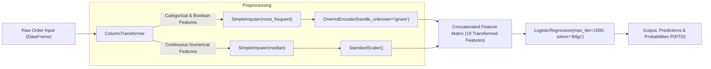

# Day 2: Data Preprocessing Pipeline & Baseline Logistic Regression Model

**Project:** E-Commerce Post-Dispatch RTO Risk Predictor  
**Date:** Day 2 Implementation  
**Script:** [`src/train_model.py`](file:///Users/saimpugowtham/Desktop/PROJECTS/RTO-Risk-Predictor/src/train_model.py)

---

## 1. Feature Selection & Leakage Prevention Strategy

We strictly isolate features observable **at checkout / before order dispatch**.

### A. Included Pre-Dispatch Features (10 Features)

| Feature | Feature Type | Transformer Pipeline Applied | Rationale |
| :--- | :--- | :--- | :--- |
| `payment_mode` | Categorical (`COD`, `PREPAID`) | `SimpleImputer(most_frequent)` + `OneHotEncoder(ignore)` | Dominant RTO driver (COD 25.61% vs Prepaid 1.41%). |
| `category` | Categorical (6 verticals) | `SimpleImputer(most_frequent)` + `OneHotEncoder(ignore)` | Fashion RTO is 27.74% while Electronics is 6.25%. |
| `pincode_tier` | Categorical (`metro`, `tier_1`, `tier_2`, `tier_3`) | `SimpleImputer(most_frequent)` + `OneHotEncoder(ignore)` | Urbanization proxy (RTO doubles from metro to tier_3). |
| `is_festive` | Boolean / Binary (`True`, `False`) | `SimpleImputer(most_frequent)` + `OneHotEncoder(ignore)` | Captures festive buying frenzy and courier strain. |
| `is_alternate_address` | Boolean / Binary (`True`, `False`) | `SimpleImputer(most_frequent)` + `OneHotEncoder(ignore)` | Deliveries away from home address carry higher delivery friction. |
| `order_value` | Continuous Numerical (₹) | `SimpleImputer(median)` + `StandardScaler()` | Order price magnitude affects buyer commitment. |
| `discount_pct` | Continuous Numerical (0.0 to 0.715) | `SimpleImputer(median)` + `StandardScaler()` | High discounts correlate with impulse purchasing. |
| `delivery_days_est` | Continuous Numerical (days) | `SimpleImputer(median)` + `StandardScaler()` | Longer transit delays increase doorstep cancellations. |
| `account_age_days` | Continuous Numerical (days) | `SimpleImputer(median)` + `StandardScaler()` | Customer account maturity at moment of purchase. |
| `order_velocity_24h` | Numerical Count (0, 1, 2) | `SimpleImputer(median)` + `StandardScaler()` | Detects multi-order checkout bursts. |

### B. Explicitly Excluded Columns
- **Surrogate IDs & PII:** `order_id`, `customer_id`, `customer_name`, `phone`, `address_line`.
- **Temporal Sorting Column:** `order_ts` (reserved solely for chronological ordering).
- **Redundant / Collinear Columns:** `order_value_band`, `signup_date`, `is_cod` (redundant with `payment_mode`).
- **High Cardinality Geography:** `pincode`, `city`, `district`, `state` (summarized cleanly by `pincode_tier`).
- **Latents & Post-Dispatch Data:** `_pincode_rto_prior`, `_reliability_z`, `_address_quality`, `_p_rto_true`, and all courier delivery attempt notes.

---

## 2. Scikit-Learn Pipeline Architecture



---

## 3. Baseline Validation Results (Threshold = 0.50)

Evaluated strictly on the held-out chronological **Validation Set** ($N = 5,000$ orders, Jan 22, 2025 to Mar 16, 2025):

| Metric | Baseline Score | Percentage | Business Interpretation |
| :--- | :--- | :--- | :--- |
| **Accuracy** | `0.8446` | **84.46%** | High baseline accuracy driven by class imbalance (84.5% non-RTO). |
| **Precision** | `0.4773` | **47.73%** | When the model flags an order as RTO, it is correct ~48% of the time. |
| **Recall** | `0.0271` | **2.71%** | At standard 0.50 threshold, it catches only 21 of 775 actual RTOs. |
| **F1-Score** | `0.0513` | — | Harmonic mean of precision and recall (heavily depressed by low recall). |
| **ROC-AUC** | `0.7994` | **~ 80.0%** | **Strong ranking ability.** Logistic Regression separates high-risk from low-risk orders with ~0.80 AUC. |

### Validation Confusion Matrix (at threshold 0.50)

$$\begin{pmatrix} \text{True Negatives (TN)} = 4,202 & \text{False Positives (FP)} = 23 \\ \text{False Negatives (FN)} = 754 & \text{True Positives (TP)} = 21 \end{pmatrix}$$

> [!NOTE]
> **Why Recall is 2.71% at Threshold 0.50:**
> Because RTO is an imbalanced event (15.5% base prevalence in validation), the raw predicted probabilities rarely exceed 0.50 unless an order has extreme risk indicators. In Day 3, we address this directly via **class weighting (`class_weight="balanced"`)** and **cost-optimal probability threshold tuning** (e.g. evaluating at 0.30 and 0.40).

---

## 4. Learned Model Coefficients (Interpretability)

Logistic Regression models the log-odds of RTO:
$$\ln\left(\frac{P(\text{RTO})}{1 - P(\text{RTO})}\right) = \beta_0 + \sum_{j=1}^p \beta_j X_j$$

### Top Drivers Increasing RTO Risk ($\beta_j > 0$)
1. **`cat__payment_mode_COD` ($\beta = +1.0970$, Odds Ratio = $3.00$):** Choosing COD triples the odds of RTO compared to the baseline.
2. **`cat__category_fashion` ($\beta = +0.7346$, Odds Ratio = $2.08$):** Fashion items more than double the odds of return due to sizing, color, and fabric expectation mismatch.
3. **`num__delivery_days_est` ($\beta = +0.1306$, Odds Ratio = $1.14$):** Every standard deviation increase in estimated shipping time increases RTO odds by 14%.
4. **`num__discount_pct` ($\beta = +0.1214$, Odds Ratio = $1.13$):** Deeper discounts encourage low-commitment ordering.
5. **`num__order_value` ($\beta = +0.0024$, Odds Ratio = $1.002$):** Slight positive tilt for high-value orders.

### Top Drivers Decreasing RTO Risk ($\beta_j < 0$)
1. **`cat__payment_mode_PREPAID` ($\beta = -2.0261$, Odds Ratio = $0.13$):** Prepaying slashes the odds of RTO by **87%**.
2. **`cat__category_electronics` ($\beta = -0.6317$, Odds Ratio = $0.53$):** Electronics orders have nearly 47% lower odds of return.
3. **`cat__is_festive_False` ($\beta = -0.5750$, Odds Ratio = $0.56$):** Regular off-peak season orders have lower return rates.
4. **`cat__category_home_kitchen` ($\beta = -0.4356$, Odds Ratio = $0.65$):** Home/kitchen utilities exhibit lower return rates.

---

## 5. Interview-Ready Walkthrough of 4 Core ML Concepts

### Concept 1: Why Categorical Encoding is Required
* **Explanation:** Machine learning models like Logistic Regression and Neural Networks are fundamentally mathematical equations ($w^T x + b$) that operate strictly on continuous vector spaces. They cannot perform arithmetic on arbitrary text strings like `"COD"`, `"fashion"`, or `"tier_2"`.
* **Our Implementation:** We apply **One-Hot Encoding** (`OneHotEncoder(handle_unknown="ignore")`). It maps each categorical level to a binary indicator column ($0$ or $1$). This avoids imposing a fake numeric hierarchy (e.g., arbitrarily assigning `fashion=1, electronics=2` which would falsely imply that electronics is "twice" fashion). Setting `handle_unknown="ignore"` guarantees that unseen categories in production do not crash the pipeline.

### Concept 2: Why `fit()` is Called ONLY on Training Data (Preventing Data Leakage)
* **Explanation:** In production, a machine learning model only ever has access to past historical data; future orders have not yet occurred.
  - If we call `fit()` or `fit_transform()` on the whole dataset or on the validation/test sets, statistics calculated during preprocessing (such as the **mean** and **standard deviation** in `StandardScaler`, or the **most frequent category** in `SimpleImputer`) will incorporate information from future orders.
  - This is known as **data leakage** (specifically distribution leakage). It artificially inflates validation metrics and causes the model to fail when deployed in production.
* **Our Implementation:**
  ```python
  # CORRECT: Fit ONLY on training split
  pipeline.fit(X_train, y_train)

  # Transform validation split using parameters learned strictly from training
  val_preds = pipeline.predict(X_val)
  val_probs = pipeline.predict_proba(X_val)[:, 1]
  ```

### Concept 3: What `fit()`, `predict()`, and `predict_proba()` Do
* **`fit(X, y)`:** Computes and learns internal model parameters from training data.
  - In `StandardScaler`: Computes $\mu$ (mean) and $\sigma$ (standard deviation) for each numerical column.
  - In `OneHotEncoder`: Identifies the distinct categories present in each categorical column.
  - In `LogisticRegression`: Solves the convex optimization problem (via L-BFGS) to find optimal weights $\mathbf{w}$ and bias $b$ that minimize binary cross-entropy loss.
* **`predict_proba(X)`:** Computes the calibrated probability distribution across classes using the sigmoid function:
  $$P(y = 1 \mid \mathbf{x}) = \sigma(\mathbf{w}^T \mathbf{x} + b) = \frac{1}{1 + e^{-(\mathbf{w}^T \mathbf{x} + b)}}$$
  Outputs a matrix of shape $(N, 2)$ where column 0 is $P(\text{Delivered})$ and column 1 is $P(\text{RTO})$.
* **`predict(X)`:** Converts continuous probabilities into discrete binary class labels ($\hat{y} \in \{0, 1\}$) by applying a hard threshold (default $0.50$):
  $$\hat{y} = \begin{cases} 1 & \text{if } P(y = 1 \mid \mathbf{x}) \ge 0.50 \\ 0 & \text{otherwise} \end{cases}$$

### Concept 4: Why `Pipeline` Guarantees Consistent Transformations
* **Explanation:** In manual preprocessing workflows, data scientists often perform imputation, scaling, and encoding through separate script steps. In deployment, developers must manually recreate those exact transformations in the exact same sequence. If any step is missed or applied with different parameters, the model receives corrupted inputs (training-serving skew).
* **Our Implementation:** Scikit-learn's `Pipeline` bundles the `ColumnTransformer` (imputation, encoding, scaling) and the `LogisticRegression` estimator into a single, unified, serializable object.
  - Calling `pipeline.predict(new_order_df)` automatically routes the raw order through the imputers, one-hot encoder, and standard scaler before generating predictions.
  - This eliminates training-serving skew and makes model serialization (`joblib.dump`) airtight.
